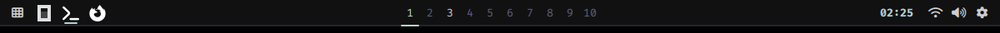
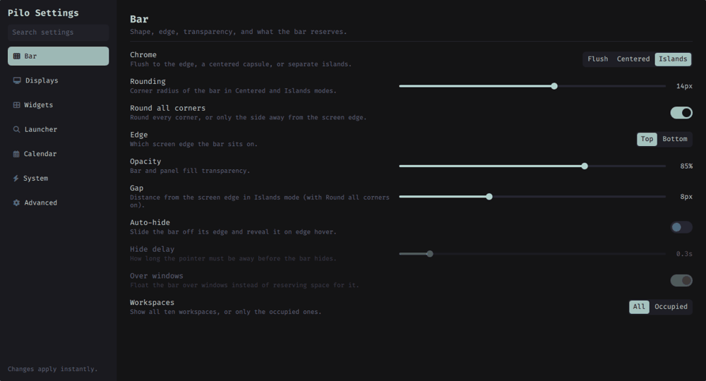

# Pilo bar

A desktop status bar for Hyprland. It sits on every monitor and replaces the
old bar. Pilo also provides its own notifications; the wallpaper picker and the
clipboard keep working as before.

## The bar

Three sections, left to right:

**Left**
- **Launcher** — opens the application launcher.
- **Running apps** — icons for everything you have open.

**Center**
- **Workspaces** — the 1–10 workspaces. Click a number to switch. The active
  one is highlighted and underlined; occupied ones are brighter. You can show
  all ten or only the ones in use (bar settings).

**Right**
- **Clock** — the time, 24-hour by default. You can switch to a 12-hour (AM/PM)
  or custom format and add the day and/or date. Click it to open the calendar.
- **Network & Bluetooth** — connection status and controls.
- **Sound** — volume and output device.
- **Settings** — customize the bar and arrange your screens.

Only one panel is open at a time. Click anywhere else to close it.

## Launcher

Two ways to open it:
- **Click the launcher icon** on the bar — it appears right under the icon.
- **Tap Super** — it opens as a centered window.

Type to search your applications, or switch to searching files. Results can be
sorted by name, most recently used, or most frequently used. Press **Tab** to
switch between apps and files. The buttons along the bottom let you shut down,
reboot, sign out, or suspend; the destructive ones ask for confirmation first.
The search box is empty every time it opens.

## Clock & calendar

The clock sits on the bar and opens the calendar when clicked. In **Clock /
Calendar** settings you choose the time format (24-hour, 12-hour AM/PM, or your
own pattern), and what the bar shows — the clock alone, or with the date and/or
the day name. If a date is shown you pick its format (presets or your own), and
if the day name is shown you pick full (`Monday`) or short (`Mon`).

The calendar opens under the clock. Move between months with the arrows, the
left/right arrow keys, or the scroll wheel. Today is highlighted. Holidays are
marked in amber and their name shows in the footer. You can set the first day of
the week (Monday or Sunday), show ISO week numbers, turn holiday marks off or
on, and hide the holiday-name footer.

## Control panels

- **Network & Bluetooth** — toggle Wi-Fi, pick a network, connect to a new one,
  and connect or disconnect paired Bluetooth devices. Networking works through
  NetworkManager, iwd (`iwctl`), ConnMan (`connmanctl`), or wpa_supplicant
  (`wpa_cli`); other stacks still show accurate read-only status instead of
  reporting a false disconnect. Bluetooth uses Quickshell/BlueZ when available
  and falls back to `bluetoothctl`.
- **Sound** — adjust volume, mute, and choose the output device. PipeWire,
  PulseAudio (`pactl`), and plain ALSA (`amixer`) are supported.
- **Settings** — opens the separate Pilo Settings window (see below), including
  the **Displays** page for arranging and identifying screens.

## Notifications

Pilo is the notification daemon as well as the bar, so no separate notification
program needs to run. Toasts appear in the top-right corner of the monitor you
are using (bottom-right if the bar is docked at the bottom). They show the app
icon, title, body, an attached image when one is sent, and the app's action
buttons.

- **Click** the toast to run its default action, or close it if it has none.
- **Right-click** the toast, or click its **×**, to dismiss it.
- Hovering a toast pauses its timeout.
- Normal timeouts are respected; short timeouts are given at least 1.5 seconds.
  Low-priority notifications default to 3.5 seconds, normal ones to 6 seconds.
- **Critical** notifications stay until you dismiss them.
- Up to four toasts stack; the oldest expires when a fifth arrives.

Notifications are shown on the monitor that was focused when they arrived, so
they do not jump between screens while you read them. Pilo keeps no notification
history.

## Running apps

Icons for everything you have open, across all workspaces and monitors, grouped
by application. The focused app is underlined. More than a handful of apps
collapse into a `+N` button.

- **Left-click** an app to bring it to the front (if it has more than one
  window, you get the menu instead).
- **Right-click** an app for its menu: each window can be focused, closed
  politely, or force-killed (useful for apps that ignore the close button).
  You also get the application's own quick actions, like Steam's
  Store / Library / Friends or Firefox's New Private Window.

## Customizing the bar

Open the gear icon for **Pilo Settings** — a regular desktop window with a
category sidebar and search. Everything applies instantly and is saved.

- **Bar** — *Chrome* (Flush, Centered, Islands), *Shape* (Rounded, S-curve, or
  Bevel — how the Centered/Islands bar meets the screen edge), *Rounding*, and
  *Attach to screen edges* (square off the corners that meet a screen edge;
  with a Shape this affects the left/right edge corners), *Edge* (top or
  bottom), *Opacity*, *Auto-hide* (with a hide delay), *Over windows* (float the
  bar over windows without reserving space), and *Workspaces* (all ten, or only
  occupied).
- **Displays** — drag the screen cards left or right to set how your monitors
  are arranged, and set each screen's *refresh rate* and *scale*. **Identify**
  flashes a big number on each screen so you can tell which one is which;
  *Reset* restores the recommended settings. Changes apply immediately and are
  saved to `monitors.lua`.
- **Widgets** — choose what sits in the **Left**, **Center**, and **Right**
  sections and in what order. Drag a widget from the **Available widgets**
  palette at the bottom into a column to add it, drag rows to reorder or move
  them between columns, or drop a row back on the palette to remove it. Each
  column's **+** opens a list to add from, and *Reset layout* restores the
  default arrangement.
- **Launcher** — the default result *sort* and *file search*.
- **Clock / Calendar** — the clock's time format and contents, the date/day
  formats, holidays, first day of week, week numbers, and the holiday footer.
- **System** — the *power profile* (Battery, Balanced, Performance).
- **Advanced** — the settings file location, export or import a backup, and
  reset everything to defaults.

The search box at the top of the sidebar matches across every category and
jumps straight to the setting you pick.

## Good to know

- The bar appears on every connected screen.
- The network widget does not require a particular distribution or network
  manager. NetworkManager, iwd, ConnMan, and wpa_supplicant get controls; other
  setups still get accurate connected/disconnected and interface state from the
  kernel.
- Sound does not require PipeWire. PulseAudio and plain ALSA are used
  automatically when their clients are present.
- Bluetooth falls back to `bluetoothctl` if Quickshell cannot attach to BlueZ.
- If a Left or Right section holds more widgets than fit around the centre, the
  extra widgets are clipped instead of overlapping the workspaces.
- Notification history is not kept: a toast is gone once it expires or is
  dismissed.
- Your preferences and your app usage history are saved between sessions.
- The layout is meant to feel consistent with the rest of the desktop: it is
  dark, understated, and keyboard-friendly.
